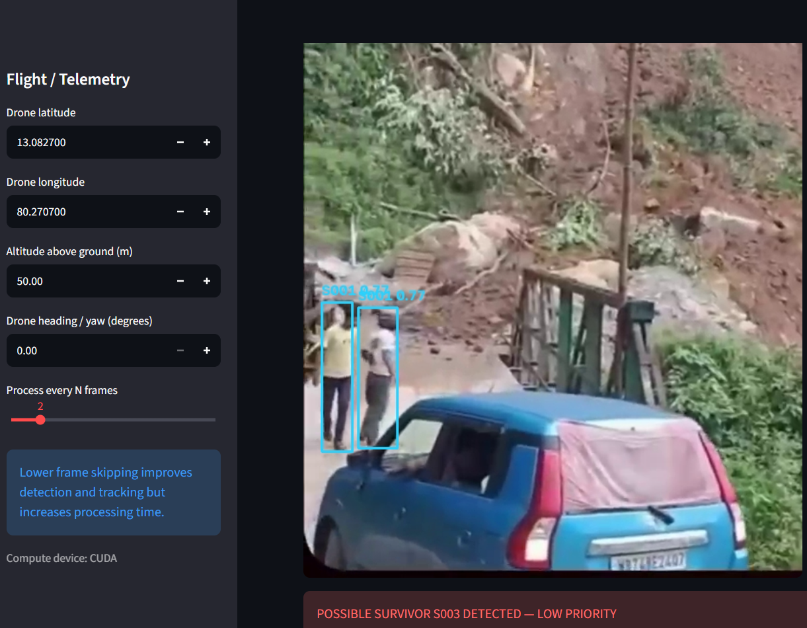

# DisasterSight

## AI-Assisted Disaster Survivor Detection and Rescue Triage

DisasterSight processes recorded drone and aerial search-and-rescue footage, turning repeated human detections into persistent, approximate, prioritised rescue candidates for human responders.

> From drone pixels to informed rescue review.

This is a hackathon MVP. It does not dispatch responders, make autonomous rescue decisions, or provide survey-grade geolocation.



## Workflow

```text
Video upload
    -> OpenCV frame sampling
    -> Vehicle detection and false-positive suppression
    -> Custom disaster SAR detector
    -> COCO person fallback
    -> Duplicate overlap suppression
    -> ByteTrack temporal tracking
    -> Candidate identity association
    -> Three-observation confirmation
    -> Approximate pixel-to-GPS projection
    -> Evidence crop and triage priority
    -> Interactive map and GeoJSON export
```

## Architecture

| Layer | Responsibility |
| --- | --- |
| Streamlit UI | Upload footage, enter telemetry, display replay, map, alerts, metrics, and exports |
| Detection fusion | Combine the custom SAR model with the COCO person fallback without double-counting |
| Vehicle filter | Suppress candidate boxes substantially overlapping cars, motorcycles, buses, or trucks |
| Tracking | Use Ultralytics ByteTrack and a higher-level image-space identity layer |
| Geolocation | Estimate latitude and longitude from the bottom-center pixel and flight telemetry |
| Triage | Score persistence and confidence, preserve evidence, and export human-review records |

See [docs/architecture.md](docs/architecture.md) and [docs/methodology.md](docs/methodology.md) for implementation details and limitations.

## Tech Stack

- **Python**
- **Streamlit** for the local responder dashboard
- **Ultralytics YOLO** for SAR, person, and vehicle detection
- **PyTorch** for model execution and CUDA selection
- **OpenCV** for video decoding, annotation, and evidence crops
- **ByteTrack** through Ultralytics for temporal tracking
- **Pandas** for map data and tabular presentation
- **NumPy** for detection processing

## Models

Place the custom disaster-specific weights at `models/best.pt`. The application uses that model when present, then supplements it with local `yolo11s.pt` COCO person detection and `yolo11n.pt` vehicle detection when available.

If the custom model is unavailable, DisasterSight remains usable in fallback demonstration mode and clearly labels that state in the interface. No model retraining is required to run the app.

## Quick Start on Windows

From the repository directory in PowerShell:

```powershell
python -m venv .venv
.\.venv\Scripts\Activate.ps1
python -m pip install -r requirements.txt
streamlit run app.py
```

Use the local URL printed by Streamlit. Enter drone latitude, longitude, altitude, and yaw; choose a frame interval; upload `mp4`, `m4v`, `mov`, `avi`, or `mkv`; then select **START DISASTER ANALYSIS**.

## Candidate Logic

- Custom SAR confidence threshold: `0.20`.
- Fallback COCO `person` class: `0`, confidence threshold `0.18`.
- Duplicate suppression: overlap-over-smaller-box at `0.60`.
- Vehicle suppression: candidate-box overlap at `0.50`; nearby people are not rejected merely for standing near vehicles.
- Confirmation threshold: `3` observations.
- Candidate IDs: `S001`, `S002`, and so on.
- GeoJSON status: `REQUIRES HUMAN REVIEW`.

Two nearby people remain separate candidates when their image-space tracks are separate. Candidates are never merged solely because their estimated GPS points are close.

## Geolocation Assumptions

The MVP uses the bottom-center of each bounding box, a nadir-facing camera, flat terrain, manually entered telemetry, 78° horizontal FOV, and 50° vertical FOV. It does not correct roll, pitch, lens distortion, terrain elevation, or changing drone pose. Locations are approximate and not survey-grade.

## Responsible Use

Every marker is an AI recommendation. Human responders must verify the video evidence, current telemetry, local conditions, and incident-command procedures before acting. The system does not replace trained search-and-rescue judgment.

## Repository Layout

```text
app.py                 Streamlit application and video workflow
utils/detection.py     YOLO loading, detector fusion, suppression
utils/tracking.py      ByteTrack identity and candidate promotion
utils/geolocation.py   Approximate pixel-to-GPS projection
utils/triage.py        Priority scoring and GeoJSON export
models/                Custom model location
docs/                  Architecture and methodology
assets/                Optional presentation assets
```

## Repository Hygiene

Local datasets, uploaded videos, training runs, virtual environments, configuration secrets, and pretrained model binaries are ignored by Git. The custom `models/best.pt` file is explicitly retained for the demo when present.
